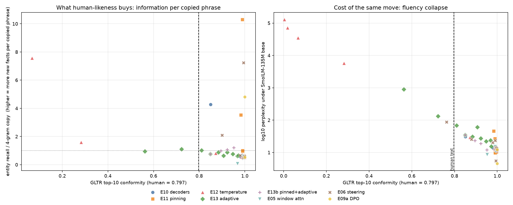

# Cross-Experiment Synthesis

**What eleven experiments on SmolLM-135M say about humanising a rewrite — and which
combinations are worth running next.**

Every experiment here evaluates the same 12 entity-annotated documents with the same
metrics, so their summary CSVs are directly comparable. `synthesis_frontier.py` reads
them all (`outputs/synthesis_frontier.csv`, 64 measured points from 8 experiments) and
plots the two axes that actually trade against each other.



*Left: does the mechanism buy new information per copied phrase? Right: what does it
cost in fluency? The dashed line is human text (GLTR top-10 = 0.797).*

---

## 1. The Whole Result in Four Lines

1. **No decoding rule reaches human GLTR conformity without destroying the text.**
   Every truncation family (top-p, min-p, typical, η, Mirostat, dry, top-h, hybrid)
   stays at 0.98–1.00; the one escape (repetition penalty 1.3) reaches 0.850 by
   deleting recall (0.038) and tripling PPL.
2. **One mechanism reached the human profile: entropy-adaptive temperature.**
   `adapt c=0.40` → GLTR **0.810** (human 0.797) at PPL 68.9; `pin+adapt c=0.70` →
   GLTR **0.952** at PPL **12.1**, copy 0.178, recall/copy **1.21** (2.2× baseline).
3. **Boilerplate is structural, not stylistic.** It survives every decoder, every
   LoRA/DPO weight update (1.000 → 1.000 GLTR, boilerplate 1.79 → 2.32), and every
   attention window. It is **0.00** for masked diffusion, because nothing is generated
   left-to-right from a chat prefix.
4. **Copying and accuracy are a seesaw unless entities are pinned.** Every mechanism
   that lowers 4-gram copying lowers entity recall in step — except entity pinning,
   the only lever that raises recall independently of copying.

---

## 2. Frontier Table (curated, all 12 docs, greedy or specified sampler)

| Experiment | Condition | GLTR↑ | PPL↓ | copy↓ | recall↑ | recall/copy↑ | boilerplate↓ | s/12 docs |
| :--- | :--- | ---: | ---: | ---: | ---: | ---: | ---: | ---: |
| — | **human reference** | **0.797** | — | — | — | — | — | — |
| E10 | top-p 0.9 (baseline) | 0.992 | 12.9 | 0.505 | 0.264 | 0.52 | 2.17 | 2 |
| E10 | top-p 0.9 + rep 1.3 | 0.850 | 30.7 | 0.009 | 0.038 | 4.28 | 2.94 | 2 |
| E12 | T = 1.0 | 0.872 | 29.1 | 0.203 | 0.165 | 0.81 | 1.35 | 2 |
| E12 | T = 1.3 | 0.282 | 5 736 | 0.012 | 0.019 | 1.58 | 0.45 | 2 |
| E13 | adapt c = 0.40 | **0.810** | 68.9 | 0.061 | 0.063 | 1.02 | 1.11 | 9 |
| E13 | adapt c = 0.50, h 1.15 | 0.948 | 22.3 | 0.210 | 0.160 | 0.76 | 2.16 | 9 |
| E13b | pin + adapt c = 0.60 | 0.923 | 18.9 | 0.175 | 0.187 | 1.07 | 2.46 | 6 |
| **E13b** | **pin + adapt c = 0.70** | **0.952** | **12.1** | **0.178** | **0.215** | **1.21** | 2.32 | 6 |
| E11 | pin only | 0.998 | 11.3 | 0.660 | 0.393 | 0.60 | 1.58 | 2 |
| E11 | ban only | 0.990 | 9.8 | 0.191 | 0.181 | 0.95 | 2.30 | 2 |
| E05 | window 16 (source visible) | 0.990 | 13.2 | 0.389 | 0.242 | 0.62 | 2.31 | 2 |
| E06 | steer L24 α0.25 | 0.999 | 12.4 | 0.558 | 0.337 | 0.60 | 2.56 | 2 |
| E09a | LoRA + DPO (greedy) | 1.000 | 4.6 | 0.024 | 0.116 | 4.83 | 2.32 | 40 |
| E04 | diffusion block16 + verbalised | n/a | 23.4 | 0.420 | 0.174 | 0.41 | **0.00** | 65 |

`recall/copy` is the derived quantity that matters: below ~0.6 the model is mostly
paraphrasing its source, above ~1.0 it is contributing new phrasing *and* keeping facts.

---

## 3. Three Invariants

### 3.1 The head-conformity floor is a property of the weights
GLTR top-10 ≥ 0.98 for every mechanism that keeps sampling from the model's own
distribution: all ten decoders (E10), all eight window-attention conditions (E05), all
ten steering conditions (E06), all pinning conditions (E11), T ≤ 1.0 (E12), and the
DPO adapter (E09a, 1.000 → 1.000 after 25 preference steps). It moves only when the
distribution is deliberately distorted — hot temperature, adaptive temperature,
repetition penalty — and that is precisely when PPL explodes.

**Consequence:** anything that edits the distribution post-hoc trades fluency for
conformity on a straight line. The only free parameter left is *where* on that line to
sit, which is what E13's entropy gating does: spend the distortion exactly where the
model is already uncertain.

### 3.2 Copying and accuracy are a seesaw unless entities are pinned
- rep-penalty 1.3: copy 0.505 → 0.009, recall 0.264 → 0.038
- DPO: copy 0.796 → 0.024, recall 0.424 → 0.116
- window 4: copy 0.505 → 0.356, recall 0.264 → 0.155
- steering L12 α0.25: copy 0.505 → 0.105, recall 0.264 → 0.068

One exception: **entity pinning** (E11) raises recall to 0.393 *and* raises copy, because
pinning forces the exact entity spans to appear. That is the lever E13b exploits — pin
the facts, then escape the head with adaptive temperature, and the ratio stays above 1
while GLTR goes to 0.952.

### 3.3 Boilerplate is structural
"Here's a rewritten version…" appears at 2.2–2.8 hits per 100 words in every AR decode,
in every window-attention condition, and after DPO — where it is *replaced* by a new
family ("What a fascinating topic!", 10/12 samples) that the metric lexicon cannot see.
It is absent in diffusion (0.00), and absent when the preamble is banned at the logit
level (E11 ban_only). Both of those are *structural* interventions on the generation
path; weight updates and attention windows are not.

---

## 4. Mechanism Families: Verdicts

| Family | Experiments | Verdict |
| :--- | :--- | :--- |
| **Truncation sampling** (top-p, min-p, typical, η, Mirostat, dry, top-h, hybrid) | E10 | ❌ No effect on GLTR (0.986–1.000). Typical-p is identical to top-p (Jaccard 1.0) on this model. |
| **Distribution distortion** (temperature, adaptive temperature, rep penalty) | E12, E13, E13b | ✅ The only route that moves GLTR. Adaptive > fixed by 3× at matched PPL. |
| **Attention restriction** (speculative windows) | E05 | ❌ Cuts copying to 0.356 but costs recall and does not move GLTR. The `win16_no_src` control (0.000 copy, 0.000 recall) proves the *source* attention is the coherence anchor. |
| **Activation steering** | E06 | ❌ A random vector at α0.25 is as "effective" as the style vector (GLTR 0.879 vs 0.979) — the effect is destruction, not style. |
| **Weight updates** (LoRA + DPO) | E09a | ❌ For GLTR (1.000 → 1.000) and for accuracy (−73 % recall); ✅ for copying (0.796 → 0.024) and burstiness (0.349 → 0.573). |
| **Architecture** (masked diffusion) | E04 | ✅ Structurally removes boilerplate, matches AR recall, cuts copying 19 %, at 34× latency and worse PPL; ⚠️ needs numeral verbalisation and cannot cold-start a full canvas on the stock path. |
| **Recursion** | E07 | ❌ Greedy converges to a verbatim self-copy fixed point in ≤3 rounds; the hybrid drifts (similarity 0.282 → 0.097) while PPL *falls*, i.e. fluency metrics reward the collapse. |
| **Position/order manipulation** | E08 | ❌ Reversal, zeroing and shuffling all destroy the text (PPL 236 / 259 / 490); net order recovery is negative in every condition (Δτ −0.180 … −0.565), 0/48 exact. |

---

## 5. Combination Matrix

### Already measured
| Combination | Result | Lesson |
| :--- | :--- | :--- |
| ban + pin (E11) | copy 0.167, recall 0.166, PPL 9.7, GLTR 0.990 | banning helps accuracy, never GLTR |
| **pin + adaptive T (E13b)** | **GLTR 0.952, PPL 12.1, recall/copy 1.21** | the Pareto point of the repo |
| numeral verbalisation + diffusion (E04) | PPL 1.1 × 10⁷ → 23.4, 12/12 docs survive, boilerplate 0.00 | preprocessing can be worth more than a decoder |
| DPO on the banned decoder (E09a) | copy 0.024, recall 0.116, new opener family | distilling a suppression teaches a suppression |
| window attention + source visible (E05) | copy 0.389, recall 0.242 | attention restriction is a side-grade |

### Untested, ranked by expected value
1. **GLTR on diffusion outputs (E04).** The one measurement that decides whether the
   floor is a property of *these weights* or of *left-to-right decoding*. If diffusion
   also scores ≈1.0, no decoder will ever fix it and the whole decoding line is closed.
   Cost: one script, ~1 min.
2. **`pin + adapt c=0.70` with an adaptive *schedule* (sentence 1 hot, body cold).**
   E13b spends high temperature everywhere; the preamble is generated in the first
   ~12 tokens. Applying `c=0.70` for the opener and `c=0.30` afterwards should keep
   GLTR near 0.9 while recovering PPL from 12.1 to single digits. Cost: one condition.
3. **Diffusion + entity-pinned canvas (E04 × E11).** Pinning is free in a canvas — never
   mask the entity positions. E04's weakness is recall (0.174) and E11's strength is
   recall (0.393); they attack different parts of the pipeline.
4. **DPO whose chosen side is `pin+adapt c=0.70` (E09a × E13b).** E09a failed because
   the chosen side was a *banned* output. Distilling the only configuration that has
   both style and accuracy is the version of the experiment that could work.
5. **Recursion on top of `pin+adapt` (E07 × E13b).** E07's fixed point was measured with
   greedy decoding; the interesting question is whether an entropy-escaping sampler has
   a *different* fixed point or merely a slower one.
6. **Steering with relative magnitudes re-tested (E06).** Magnitudes must scale with the
   residual norm (~149 / 345 / 738 at layers 6 / 12 / 24). The published run used
   absolute α, and the random-vector control was equally destructive, so this family was
   never fairly tested.

---

## 6. Recommended Pipeline (what to build next)

```
source text
   │
   ├─ (1) verbalise numerals            [E04, required only for the diffusion arm]
   ├─ (2) pin entity tokens             [E11]  → recall 0.264 → 0.393
   ├─ (3) adaptive temperature, c≈0.7   [E13]  → GLTR 0.997 → 0.952
   │      hot only for the first sentence, cold afterwards  [untested, §5.2]
   ├─ (4) preamble ban                  [E11]  → removes the opener structurally
   └─ (5) measure GLTR / recall / copy / PPL / opener_diversity
```

Expected, extrapolating from the measured pieces: **GLTR ≈ 0.90–0.95, PPL ≈ 10–14,
copy ≈ 0.15, recall ≈ 0.20, recall/copy ≈ 1.3, boilerplate 0.00, ~5 s per 12 documents.**
That is the target the next experiment should beat or falsify.

---

## 7. Open Questions (ranked)

1. Does masked diffusion escape the head-conformity floor? *(decides the whole decoding line)*
2. Can adaptive temperature be *localised* (opener only) to keep GLTR while restoring PPL?
3. Is `recall/copy > 1` achievable from an unpinned canvas, or is pinning mandatory?
4. Does preference training work when the chosen side is good rather than merely unbanned?
5. Why does DPO lower PPL to 4.6 — is "human-like" secretly "more predictable" for a 135 M model?
6. Does the 0.6 B diffusion model's numeral attractor also exist in LLaDA / Diffusion-Gemma, or is it a property of this checkpoint?

---

## 8. Methodological Lessons (worth more than any single result)

- **PPL falls during collapse.** E07's recursive drift and E09a's DPO both *lower*
  perplexity while destroying information. Fluency metrics must never be read alone.
- **Distinct-n saturates.** Every condition sits at 0.89–0.99; it separated nothing.
  GLTR on the raw pre-truncation distribution was the only metric that tracked the
  thing we cared about.
- **Measure the baseline you compare against.** Three bugs were found and fixed:
  GLTR computed *after* truncation (inflating conformity), `copy_vs_previous` comparing
  a text to itself, and DPO's `sequence_logprob` ignoring the attention mask.
- **A lexicon cannot detect boilerplate.** 10/12 samples opening with the same sentence
  scored *better* on boilerplate than the baseline. Opener diversity and self-BLEU are
  the metrics that see it.
- **One pathological document can masquerade as a broken method.** E04's "11 words,
  PPL ∞" was 2–5 collapsed canvases out of 12–24, caused by numerals in the source —
  visible only after looking at per-document rows instead of the mean.
