# 🕸️ The Humanize-Experiments Zettelkasten Thought Graph

This graph maps the cognitive intuitions, theoretical models, decoding algorithms, temporal dynamics, and experimental runs across the repository.

---

## 🗺️ Visual Topology Graph

```mermaid
flowchart TD
    %% Cognitive & Position-Free
    subgraph Cognitive ["🧠 Cognitive Representation & Non-Sequential Thought"]
        I07["IDEA-07: Position-Free Concept Memory<br><i>(Non-sequential human working memory)</i>"]
        I08["IDEA-08: Temporal Mental Imagery Stream<br><i>(JEPA-style latent scene progression)</i>"]
        I09["IDEA-09: Decoupled Syntactic Realizer<br><i>(Diffusion linearizer for unordered concepts)</i>"]
    end

    %% Decoding & Distillation
    subgraph Decoding ["⚡ Decoding & Sampling Innovations"]
        I01["IDEA-01: Inverted Nucleus Boundary<br><i>(Skip the top-p head)</i>"]
        I02["IDEA-02: Confidence-Gated Hybrid Routing<br><i>(Greedy anchor + boundary style)</i>"]
        I11["IDEA-11: Directional Embedding Vectors<br><i>(Geometric logit re-weighting)</i>"]
        I12["IDEA-12: Runner-Up Distillation Loss<br><i>(Train student on N-th best tokens)</i>"]
    end

    %% Architecture & Style
    subgraph Architecture ["🏗️ Architectural Interventions"]
        I03["IDEA-03: Full-Canvas Text Diffusion<br><i>(In-place global adaptation)</i>"]
        I04["IDEA-04: Asymmetric Window Attention<br><i>(Sliding window output + full source)</i>"]
        I05["IDEA-05: Cross-Text Tone Transfer<br><i>(Latent activation steering / AdaIN)</i>"]
    end

    %% Alignment, Persona & Intent
    subgraph Persona ["🎭 Persona Cloning, Intent & Timing"]
        I10["IDEA-10: RL Post-Training Humanizer<br><i>(DPO, detector penalty)</i>"]
        I13["IDEA-13: In-Context Persona Cloning<br><i>('Voice cloning' equivalent for LLMs)</i>"]
        I14["IDEA-14: Theory-of-Mind Intent CoT<br><i>(Think why human speaks before predicting)</i>"]
        I15["IDEA-15: Conversational Latency Reward<br><i>(Timing, typing delay & pacing policy)</i>"]
    end

    %% Attention Forensics & Temporal Memory
    subgraph Memory ["⏳ Attention Forensics & Temporal Memory"]
        I16["IDEA-16: Attention Forensics & Predictor<br><i>(Debug & forecast attention routing)</i>"]
        I17["IDEA-17: Exponential Back-Trace Decay<br><i>(Time-anchored graph memory retrieval)</i>"]
    end

    %% Validation & Dynamics
    subgraph Validation ["🔬 Stress Testing & Dynamics"]
        I06["IDEA-06: Recursive Autophagy & Context Decay<br><i>(Multi-turn AI slop collapse)</i>"]
    end

    %% Meta-Ideation & Evolutionary Discovery
    subgraph MetaIdeation ["💡 Meta-Ideation & Evolutionary Discovery"]
        I18["IDEA-18: Autonomous Idea Generator<br><i>(Novelty search, stepping stones & conceptual blending)</i>"]
    end

    %% Concrete Experiments
    subgraph Experiments ["🧪 Concrete Experiment Tracks"]
        E01["EXP-01: Pure Boundary Exploration"]
        E02["EXP-02: Hybrid Rewrite Matrix"]
        E03["EXP-03: 12-Domain Sweet Spot Tuning"]
        E04["EXP-04: Text Diffusion Rewriter"]
        E05["EXP-05: Speculative Window Attention"]
        E06["EXP-06: Tone Style Transfer"]
        E07["EXP-07: Recursive Slop & Decay Loop"]
        E08["EXP-08: Position-Free Thought Streams"]
        E09["EXP-09: RL & Persona Alignment"]
        E10["EXP-10: Directional & Runner-Up Decoding"]
        E11["EXP-11: Persona Cloning & Temporal Dynamics"]
        E12["EXP-12: Attention Forensics & Temporal Memory"]
        E13["EXP-13: Autonomous Idea Generation"]
    end

    %% Wiring
    I01 --> E01
    I01 --> I02
    I02 --> E02
    I02 --> E03
    I02 -.->|Vulnerability Check| I06
    I06 --> E07

    I11 --> E10
    I12 --> E10
    I01 -.->|Sub-optimal Learning| I12

    I03 --> E04
    I04 --> E05
    I05 --> E06

    I07 --> I08
    I08 --> I09
    I09 --> E08

    I02 -.->|Pairwise Distillation| I10
    I10 --> E09
    I13 --> E11
    I14 --> E11
    I15 --> E11

    I16 --> E12
    I17 --> E12

    I18 --> E13
    I18 -.->|Axiom Inversion| I07
    I18 -.->|Cross-Domain Analogies| I05
    I18 -.->|Temporal Stepping Stones| I08

    classDef validated fill:#2E7D32,stroke:#1B5E20,color:#fff;
    classDef planned fill:#1565C0,stroke:#0D47A1,color:#fff;
    classDef theoretical fill:#6A1B9A,stroke:#4A148C,color:#fff;

    class E01,E02,E03 validated;
    class E04,E05,E06,E07,E08,E09,E10,E11,E12,E13 planned;
    class I01,I02,I03,I04,I05,I06,I07,I08,I09,I10,I11,I12,I13,I14,I15,I16,I17,I18 theoretical;
```

---

## 🗂️ Atomic Thought Nodes Index

| Node ID | Concept Title | Primary Hypothesis | Associated Track | Tags |
| :--- | :--- | :--- | :--- | :--- |
| **[[IDEA-01]]** | [Inverted Nucleus Boundary](ideas/nodes/IDEA-01-inverted-nucleus-boundary.md) | Bypassing the top-$p$ head forces non-cliché tokens and prevents greedy repetition loops. | [`EXP-01`](experiments/01_pure_post_top_p_boundary/) | `#sampling` `#nucleus` |
| **[[IDEA-02]]** | [Confidence-Gated Hybrid Routing](ideas/nodes/IDEA-02-confidence-gated-hybrid.md) | Hard gating on $P_1 \ge \tau$ locks factual anchors while sampling post-$x$ boundary tokens for style. | [`EXP-02`](experiments/02_hybrid_adaptive_decoding/), [`EXP-03`](experiments/03_sweet_spot_tuning_and_comparison/) | `#hybrid` `#decoding` |
| **[[IDEA-03]]** | [Full-Canvas Text Diffusion](ideas/nodes/IDEA-03-full-canvas-text-diffusion.md) | Iterative discrete diffusion eliminates autoregressive exposure bias and cumulative drift. | [`EXP-04`](experiments/04_text_diffusion_global_rewrite/) | `#diffusion` `#non-autoregressive` |
| **[[IDEA-04]]** | [Asymmetric & Speculative Window Attention](ideas/nodes/IDEA-04-asymmetric-speculative-window-attention.md) | Windowed self-attention on outputs kills phrasing repetition; uncompressed source cross-attention preserves facts. | [`EXP-05`](experiments/05_speculative_window_attention/) | `#attention` `#long-context` |
| **[[IDEA-05]]** | [Latent Tone & Style Transfer](ideas/nodes/IDEA-05-latent-tone-style-transfer.md) | Steering residual activations using tone vectors from a reference text transfers cadence without corrupting facts. | [`EXP-06`](experiments/06_cross_text_tone_style_transfer/) | `#style-transfer` `#representation-engineering` |
| **[[IDEA-06]]** | [Recursive Autophagy & Context Decay](ideas/nodes/IDEA-06-recursive-autophagy-slop-decay.md) | Iterative re-humanization ($T_0 \to \dots \to T_N$) measures model autophagy, entity half-life, and AI slop collapse. | [`EXP-07`](experiments/07_recursive_humanization_context_decay/) | `#stress-test` `#slop-index` |
| **[[IDEA-07]]** | [Position-Free Concept Representations](ideas/nodes/IDEA-07-position-free-concept-representations.md) | Human memory stores concepts without rigid positional indices; position is only needed at surface realization time. | [`EXP-08`](experiments/08_position_free_thought_streams/) | `#position-free` `#cognitive-architecture` |
| **[[IDEA-08]]** | [Temporal Mental Imagery Streams via JEPA](ideas/nodes/IDEA-08-temporal-mental-stream-jepa.md) | Thinking produces a temporal sequence of latent scene states (e.g. cat $\to$ sitting $\to$ mat) rather than discrete words. | [`EXP-08b`](experiments/08_position_free_thought_streams/08b_temporal_concept_stream_jepa/) | `#jepa` `#latent-world-models` |
| **[[IDEA-09]]** | [Decoupled Syntactic Linearizer](ideas/nodes/IDEA-09-multi-stage-decoupled-syntax-linearizer.md) | Separate concept generation from surface grammar: decode unordered concepts to jumbled words, then unscramble. | [`EXP-08c`](experiments/08_position_free_thought_streams/08c_diffusion_lexical_unscrambler/) | `#multi-stage` `#diffusion-unscrambler` |
| **[[IDEA-10]]** | [RL Post-Training & Persona Modeling](ideas/nodes/IDEA-10-rl-post-training-humanization.md) | Embed humanization directly into weights via DPO distillation, detector-evasion RL, and personal user transcript cloning. | [`EXP-09`](experiments/09_rl_post_training_humanization/) | `#post-training` `#dpo` `#rlhf` |
| **[[IDEA-11]]** | [Directional Embedding Decoding](ideas/nodes/IDEA-11-directional-embedding-decoding.md) | Steer token generation by calculating the cosine projection between token embeddings and a target behavioral vector. | [`EXP-10a`](ideas/nodes/IDEA-11-directional-embedding-decoding.md) | `#directional-decoding` `#vector-steering` |
| **[[IDEA-12]]** | [Runner-Up Distillation Loss](ideas/nodes/IDEA-12-runner-up-distillation-loss.md) | Train student models on the loss of the teacher's second-best or Nth-best tokens to bypass consensus boilerplate. | [`EXP-10b`](ideas/nodes/IDEA-12-runner-up-distillation-loss.md) | `#distillation` `#anti-generic` |
| **[[IDEA-13]]** | [Zero-Shot Persona Cloning for LLMs](ideas/nodes/IDEA-13-zero-shot-persona-cloning-llm.md) | 'Voice cloning' for text: condition the LLM on a short reference sample via latent vectors rather than prompt mimicry. | [`EXP-11a`](ideas/nodes/IDEA-13-zero-shot-persona-cloning-llm.md) | `#persona-cloning` `#in-context-conditioning` |
| **[[IDEA-14]]** | [Theory-of-Mind Intent Rationalization](ideas/nodes/IDEA-14-theory-of-mind-intent-rationalization.md) | Intermediate CoT thinking step rationalizing why a human spoke before generating a response or predicting their next turn. | [`EXP-11b`](ideas/nodes/IDEA-14-theory-of-mind-intent-rationalization.md) | `#theory-of-mind` `#next-human-prediction` |
| **[[IDEA-15]]** | [Conversational Latency & Pacing Reward](ideas/nodes/IDEA-15-conversational-latency-temporal-reward.md) | Reward model optimizing when to respond, conversational pauses, and typing delays matching cognitive complexity. | [`EXP-11c`](ideas/nodes/IDEA-15-conversational-latency-temporal-reward.md) | `#temporal-dynamics` `#conversational-pacing` |
| **[[IDEA-16]]** | [Attention Forensics & Meta-Model](ideas/nodes/IDEA-16-attention-weight-forensics-and-prediction.md) | Extract conversational cross-attention maps and train a predictive meta-model to forecast optimal attention routing. | [`EXP-12a`](ideas/nodes/IDEA-16-attention-weight-forensics-and-prediction.md) | `#attention-forensics` `#interpretability` |
| **[[IDEA-17]]** | [Temporal Graph Decay & Back-Trace](ideas/nodes/IDEA-17-temporal-graph-decay-exponential-backtrace.md) | Exponential recency decay in graph memory with selective temporal back-tracing when historical anchors are referenced. | [`EXP-12b`](ideas/nodes/IDEA-17-temporal-graph-decay-exponential-backtrace.md) | `#temporal-memory` `#recommendation-systems` |
| **[[IDEA-18]]** | [Autonomous Idea Generator](ideas/nodes/IDEA-18-autonomous-idea-generator-stepping-stones.md) | Novelty-search algorithm that escapes the LLM convex hull via axiom inversion, cross-domain blending, and temporal stepping-stone incubation. | [`EXP-13`](ideas/nodes/IDEA-18-autonomous-idea-generator-stepping-stones.md) | `#novelty-search` `#idea-generator` `#conceptual-blending` |
